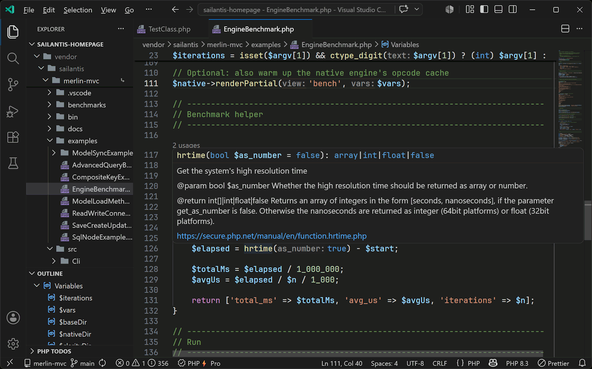
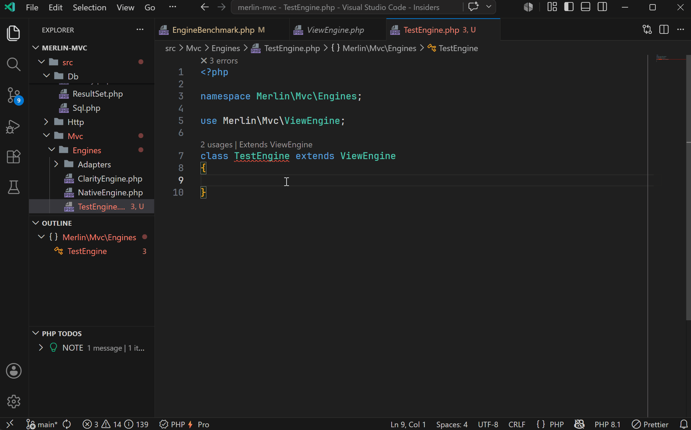
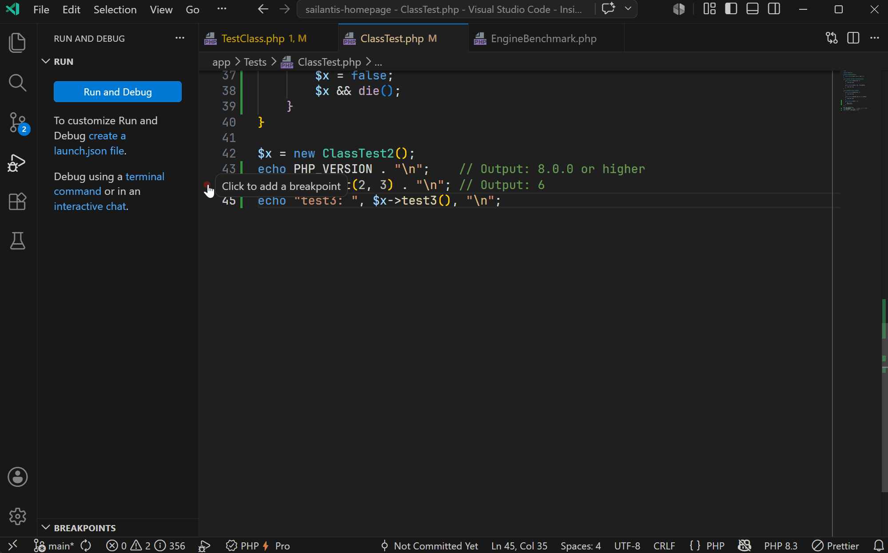
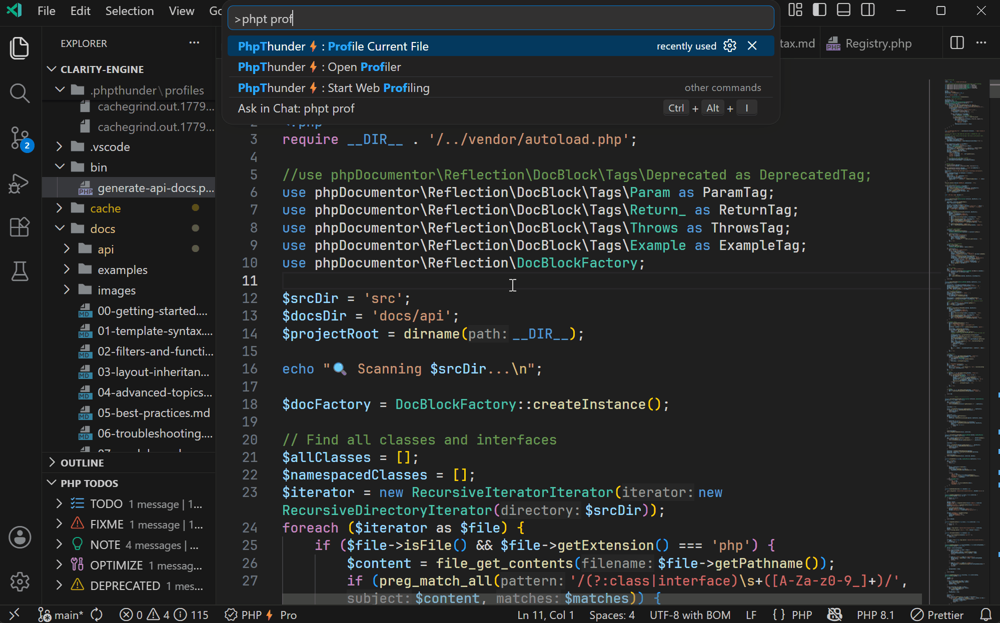

# PhpThunder Documentation

PhpThunder is a PHP language server, debugger, and workflow extension for VS Code. It combines code intelligence, diagnostics, formatting, tests, debugging, Composer workflows, and a built-in profiler in a single extension.

This repository is the canonical markdown source for the long-form product documentation.

## Highlights

### Code intelligence

Context-aware completion, PHPDoc-aware hover, go-to-definition, find references, and import assistance. PhpThunder understands templates, array shapes, callable signatures, conditional return types, magic methods, fluent APIs, and type aliases — and inlay hints show inferred parameter names and return types inline.

→ [Editor features](docs/03-editor-features.md)

### Diagnostics and code actions

Inline diagnostics for parse errors, type mismatches, array-shape key problems, unused imports, unused private members, and unreachable code. Quick fixes generate abstract methods, add missing imports, and apply type fixes.

→ [Diagnostic codes](docs/10-diagnostic-codes.md)

### Debugging

Xdebug-based debugging for CLI scripts, web requests, and attach mode, with full VS Code debug adapter support: breakpoints, conditional breakpoints, watch expressions, call stack, and variable inspection.

→ [Debugging](docs/04-debugging.md)

### Profiling

Profile any PHP file directly from the editor. The profiler panel visualizes execution time, call counts, and hotspots as a flame graph.

→ [Profiling](docs/05-profiling.md)

## Quick start

1. Install the extension from the VS Code Marketplace.
2. Open a PHP workspace and click the status bar item to open the settings panel.
3. Run `PhpThunder: Select PHP Version` and choose the version the project targets.
4. Run `PhpThunder: Configure PHP Interpreters` to use a specific PHP binary.
5. Run `PhpThunder: Reindex Workspace` if you encounter issues after making changes via Composer, or regarding include path settings or the workspace structure in general.

For a complete walkthrough, see [Getting started](docs/01-getting-started.md).

## Start here

### New to PhpThunder

- [Getting started](docs/01-getting-started.md)
- [Installation and activation](docs/02-installation-and-activation.md)
- [Editor features](docs/03-editor-features.md)

### Need a workflow

- [Debugging](docs/04-debugging.md)
- [Profiling](docs/05-profiling.md)
- [Testing](docs/06-testing.md)

### Need configuration or policy

- [Project configuration](docs/07-project-configuration.md)
- [Free vs Pro](docs/08-free-vs-pro.md)
- [Diagnostic codes](docs/10-diagnostic-codes.md)
- [Release versioning](docs/11-release-versioning.md)

### Need support

- [Troubleshooting](docs/09-troubleshooting.md)

## Free and Pro

PhpThunder's free tier is a complete PHP development workflow: code intelligence, diagnostics, formatting, PHPUnit and Pest test discovery, Xdebug debugging, and Composer helpers. Pro adds the workflows that remove repetitive friction at scale.

| Capability                       | Free | Pro                     |
| -------------------------------- | ---- | ----------------------- |
| Code intelligence & navigation   | ✓    | ✓ + starred suggestions |
| Diagnostics & basic code actions | ✓    | ✓ + Pro code fixes      |
| Formatting                       | ✓    | ✓ + style customization |
| PHPUnit & Pest (Test Explorer)   | ✓    | ✓                       |
| Xdebug debugging                 | ✓    | ✓ + inline debug values |
| Composer helpers & TODO tools    | ✓    | ✓                       |
| Rename Symbol                    |      | ✓                       |
| Accessor generation              |      | ✓                       |
| Implement Missing Methods        |      | ✓                       |
| Profiling (CLI & web)            |      | ✓                       |

Pro includes a 30-day trial that starts automatically on first install. See [Free vs Pro](docs/08-free-vs-pro.md) for the full breakdown and status bar states.

## Getting help

- Report a bug or request a feature on [GitHub](https://github.com/sailantis/phpthunder-ext/issues).
- Reach the team privately through the [support page](https://www.sailantis.com/support).
